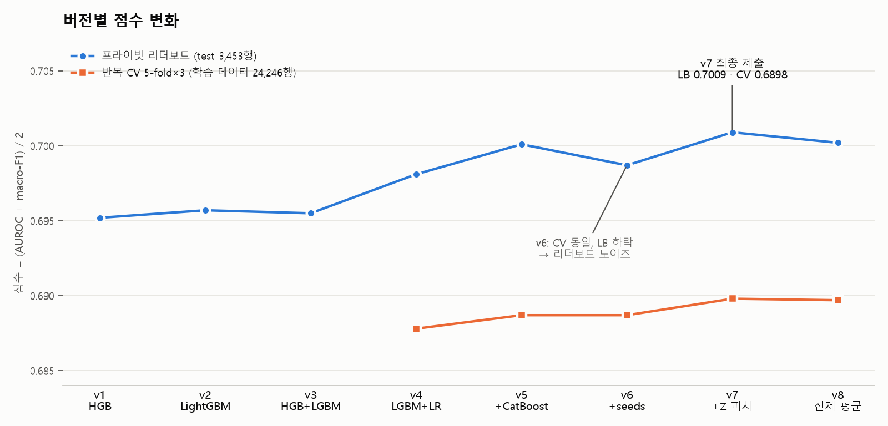

# 비타민 D 결핍 예측 — 국민건강영양조사 207개 변수 기반 분류 모델

> 수원대학교 머신러닝프로젝트 수업 (2026-2) 기말 평가 과제 (수강생 44명이 같은 데이터로 모델을 만들어 리더보드로 평가)
> 성인의 건강·영양·생활 변수 207개로 **비타민 D 결핍 확률**을 예측하는 이진 분류 문제

| | |
|---|---|
| **최종 모델** | LightGBM 4종 + CatBoost 2종 + 로지스틱 회귀 앙상블 (v7) |
| **최종 순위** | **44명 중 16위** (최종 점수 0.68919) |
| **프라이빗 리더보드** | 0.70091 (AUROC 0.7366 · macro-F1 0.6652) · 18위 |
| **히든 final** (같은 시기 비공개 데이터) | 0.69987 · 16위 |
| **히든 late** (2022~2024, 측정법 변경) | AUROC 0.66323 · 15위 |
| **반복 교차검증** | 0.6898 (5-fold × 3회) |




<br>

## 1. 문제 정의

| 항목 | 내용 |
|---|---|
| 데이터 | 학습 20,776명 + 검증 3,470명 (합쳐서 학습), 테스트 3,453명 · 변수 207개 |
| 라벨 | `vdd` (1 = 결핍) · 양성 비율 68% |
| 평가 지표 | **(AUROC + macro-F1) / 2** · macro-F1은 확률 0.5 기준으로 계산 |
| 최종 점수 | 0.3 × 프라이빗 리더보드 + 0.7 × 히든 리더보드 (공개되지 않은 데이터, 세부 구성은 평가 종료 후 공개 → 8장) |
| 제출물 | `inference.py` + 모델 파일 → 인터넷이 막힌 격리 환경(**CPU 1코어 · 8GB · 5분**)에서 다시 실행해 제출 결과와 일치하는지 검사 |

> 최종 점수의 70%가 보이지 않는 데이터에서 나옵니다.
> 그래서 **리더보드가 아니라 교차검증만으로 모델을 고르는 것**을 처음부터 원칙으로 정했습니다.

<br>

## 2. 데이터에서 발견한 것

- **결측 코드 3종**: 빈 칸(미조사), `-1`(해당 없음), `-2`(모름·무응답)
  - `-1`은 정보가 있는 값이라 그대로 두고, `-2`만 결측으로 처리
- **결측 패턴이 강한 신호**: 여러 변수가 묶음으로 함께 비고, 이 패턴이 라벨과 강하게 연관됨
  - 조사 연도(기수)마다 조사 항목이 달라서 생기는 패턴으로 추정
  - 연도별 검사 환경 차이까지 반영하는 피처(Z 피처, 5장)로 발전
- **`dr_month` 는 월이 아님**: 0/1 이진 변수라 계절 정보는 쓸 수 없었음
- **학습·테스트 분포 동일**: Adversarial validation AUC 0.495 → 일반 교차검증을 그대로 신뢰 가능

<br>

## 3. 검증 전략 — 이 프로젝트의 핵심

**왜 리더보드를 믿지 않았나**

- 테스트 3,453행에서 macro-F1은 경계 근처 수십 명의 판정만 바뀌어도 ±0.004쯤 흔들립니다.
- 리더보드 상위권 차이(0.70~0.707)가 이 노이즈와 비슷한 크기입니다.
- 그래서 리더보드를 보고 고르면 운이 좋았던 모델을 고르게 됩니다.

**세운 규칙**

1. **반복 교차검증**: StratifiedKFold 5-fold × 3회 (seed 100, 101, 102)
   - 모든 실험이 같은 분할을 쓰도록 고정
   - 각 실험의 OOF 예측을 저장해 앙상블 실험에 재사용
2. **채택 기준**: 기존보다 **평균 +0.0010 이상** 그리고 **3회 모두 상승**할 때만 채택
3. **선택 편향 점검**: 많은 후보 중에서 고른 결과는 낙관적으로 나옴
   - 행을 반으로 나눠 한쪽에서 고르고 다른 쪽에서 평가 ([`exp14_check.py`](src/exp14_check.py))

**실제 사례 (v6)**

- seed 수만 늘린 v6는 CV가 v5와 같았는데, 리더보드는 0.7001 → 0.6987로 떨어졌습니다.
- AUROC는 0.7352로 완전히 같았고, 경계에 있던 35명의 판정만 바뀌어 macro-F1이 내려갔습니다.
- 리더보드가 노이즈라는 것을 직접 확인해서 v5를 유지했습니다.

<br>

## 4. 모델 발전 과정

| 버전 | 변경 내용 | 반복 CV | 프라이빗 LB |
|---|---|---|---|
| v1 | HistGradientBoosting 기본 모델 | – | 0.6952 |
| v2 | LightGBM + 결측 패턴·비율 피처, 3 seed 평균 | – | 0.6957 |
| v3 | HGB + LightGBM 앙상블 | – | 0.6955 |
| v4 | 범주형 지정 + **타깃 인코딩**(조합 6개) + 파라미터 탐색 + 로지스틱 회귀 혼합 | 0.6878 | 0.6981 |
| v5 | **CatBoost** 추가 (LGBM .55 / CatBoost .30 / 로지스틱 .15) | 0.6887 | 0.7001 |
| v6 | seed만 늘림 (LGBM 3→10, CatBoost 3→6) | 0.6887 | 0.6987 |
| **v7** | **조사 연도 추정 피처(Z)** + LightGBM 변형 4종 · CatBoost 2종 평균 | **0.6898** | **0.7009** |
| v8 | 모든 변형을 가중치 선택 없이 평균 (가장 보수적인 후보) | 0.6897 | 0.7002 |

> 최종 제출본은 v7이며, 평가 서버의 격리 환경 재실행 결과가 제출 파일과 일치함(모델 정합 검사 통과)을 확인했습니다.

> v1~v3은 반복 CV 체계를 만들기 전이라 같은 기준의 CV 값이 없습니다.
> v4 이전에 제출한 한 버전은 로지스틱 회귀의 `SplineTransformer` 가 평가 서버의 scipy 버전과 맞지 않아 실행에 실패했고, 구간 원-핫(`KBinsDiscretizer`)으로 바꿔 해결했습니다.

<br>

## 5. 주요 기법

### 피처 엔지니어링 ([`train_lgbm.py`](src/train_lgbm.py), [`exp7.py`](src/exp7.py))
- **결측 패턴**: 행별 빈 칸·`-1`·`-2` 개수, 변수 묶음별 결측 여부와 이를 비트로 합친 패턴 번호
- **비율 변수**: BUN/크레아티닌, AST/ALT, 중성지방/HDL, 영양소 섭취량 ÷ 총 에너지
- **타깃 인코딩**: 지역×도시, 직업×성별, 성별×나이 5세 구간 등 조합 6개. scikit-learn `TargetEncoder` 의 cross-fitting으로 학습 데이터 누수를 막음
- **Z 피처 (v7에서 가장 효과적)**:
  1. 결측 상관 기반 계층적 군집으로 "함께 비는 변수 묶음" 4개를 자동 탐지 → 묶음 패턴 번호 `bsig` (조사 연도 대리 변수)
  2. 같은 `bsig` 그룹 안에서 혈액검사 수치 10개를 log 후 표준화 → 연도별 검사 기기·기준 차이를 제거한 상대 수치

### 앙상블
- **LightGBM**: 기본, 깊은 트리, extra-trees, 낮은 학습률 4종 (각 3 seed)
- **CatBoost**: 범주형을 자체 ordered target statistics로 처리, 기본 + Z 피처 2종 (각 3 seed)
- **로지스틱 회귀**: 원-핫 + 구간화 + 표준화. 트리와 오차 패턴이 달라 다양성 확보
- 가중치는 스태킹(로지스틱 메타 모델, 중첩 CV)으로 확인한 비율 .55 / .30 / .15를 사용

### 임계값 단조 변환
- macro-F1은 0.5 기준으로 계산되는데, 양성 비율이 68%라 최적 기준은 약 0.62입니다.
- OOF로 찾은 최적 임계값 *t*를 0.5로 옮기는 **단조 변환**을 적용했습니다.

```python
pred = np.where(p < t, 0.5 * p / t, 0.5 + 0.5 * (p - t) / (1 - t))
```

순서가 보존되므로 AUROC는 그대로, macro-F1만 최적점으로 이동합니다.

<br>

## 6. 효과가 없었던 시도

같은 반복 CV 기준으로 측정했고, 채택 기준을 넘지 못해 쓰지 않았습니다.

| 시도 | 결과 |
|---|---|
| XGBoost | 단독 0.6866, LightGBM과 상관 0.989 → 앙상블 이득 없음 |
| 스태킹 메타 모델 | ≤ 0.6887 (고정 가중치와 같음) |
| LightGBM dart / GOSS / linear tree | 0.6846 / 0.6853 / 0.6862 (기본보다 낮음) |
| 수작업 상호작용 피처 (나이×성별 등) | 단독 0.6886, 앙상블 이득 없음 |
| RBF 커널 근사(Nystroem) + 로지스틱 | 단독 0.6121 |
| MLP 신경망 / ExtraTrees | 단독 0.6604 / 0.6698, 앙상블 이득 없음 |
| 비슷한 사람 50명의 결핍률 피처 (KNN, 누수 방지 OOF) | 0.6839 (기준 LightGBM 0.6872보다 낮음) |
| 자동 앙상블 선택 (Caruana, 23개 후보) | 같은 데이터에서 0.6903이었지만, 행 분할 검증에서 이득 +0.0002로 축소 → 선택 편향으로 판단하고 버림 |

<br>

## 7. 배운 점

**1. 작은 테스트셋의 리더보드는 노이즈가 크다**
- AUROC가 같은 두 모델도 macro-F1이 0.003 차이 날 수 있습니다.
- 그래서 반복 CV, 그중에서도 덜 흔들리는 AUROC를 함께 봤습니다.

**2. 많이 시도할수록 고르는 과정 자체가 과적합을 만든다**
- 자동 앙상블 탐색의 +0.0016은 대부분 선택 편향이었습니다.
- 가중치를 고르지 않는 단순 평균이 더 믿을 만했습니다.

**3. 데이터 구조를 읽는 것이 모델 튜닝보다 크다**
- 25가지 넘는 모델·파라미터 변형보다, 결측 패턴으로 조사 시기를 추정한 피처 하나가 더 확실했습니다 (AUROC +0.001, 3회 모두 상승).

**4. 배포 환경 재현성**
- 평가 서버의 라이브러리 버전 차이로 실행이 실패한 뒤로, 제출 전마다 빈 폴더·CPU 1코어·격리 모드(`python -I`)에서 실행해 결과 일치를 확인했습니다.

<br>

## 8. 최종 결과

평가가 끝난 뒤 공개된 히든 평가는 두 데이터로 나뉘어 있었습니다.

**최종 점수 = 0.3 × 프라이빗 + 0.4 × 히든 final + 0.3 × 히든 late**

| 평가 데이터 | 내용 | 점수 | 순위 (44명) |
|---|---|---|---|
| 프라이빗 | 제출 중 공개 리더보드 (test 3,453명) | 0.70091 | 18위 |
| 히든 final | 학습 데이터와 같은 시기(2008~2014)의 비공개 데이터 | 0.69987 | 16위 |
| 히든 late | 2022~2024년 데이터. 비타민 D 측정법이 RIA → LC-MS로 바뀌어 결핍 비율이 크게 달라, AUROC만 반영 | 0.66323 | 15위 |
| **최종** | | **0.68919** | **16위** |

**보이는 점수 vs 보이지 않는 점수**
- 프라이빗 → 히든 final 하락폭: −0.0010 (참가자 중앙값 −0.0009와 비슷)
- 프라이빗 상위 10명은 평균 −0.0021 하락, 그중 7명이 더 크게 떨어짐
- 순위: 프라이빗 18위 → 히든 final **16위**

**시기가 다른 데이터에서의 한계**
- 측정법이 바뀐 2022~2024년 데이터에서는 모든 참가자의 AUROC가 0.62~0.67로 크게 낮아졌습니다.
- 학습 데이터와 다른 시기의 분포 변화(dataset shift)는 교차검증으로 미리 확인할 수 없는 위험입니다.

<br>

## 9. 저장소 구조

```
├── README.md
├── requirements.txt
├── results/
│   ├── score_progress.png     # 버전별 점수 그래프
│   ├── overnight_log.txt      # 마지막 실험 라운드 전체 로그 (25가지 변형)
│   └── search_best.json       # LightGBM 하이퍼파라미터 탐색 결과
├── submission/
│   └── inference.py           # 최종 제출 추론 코드 (v7)
└── src/
    ├── data/                  # 과제 데이터 위치 (저장소에 미포함)
    ├── train_lgbm.py          # 기본 전처리 fe()
    ├── exp2.py                # 반복 CV 공통 함수, 타깃 인코딩 조합
    ├── exp3.py ~ exp15.py     # 실험 (각 파일 상단에 목적·비교 기준 설명)
    ├── exp_lr.py              # 로지스틱 회귀 파이프라인
    ├── exp14_check.py         # 선택 편향 점검 (행 분할)
    ├── train_final.py         # v4 학습
    ├── train_v5.py            # v5 학습 (v4 + CatBoost)
    ├── train_v6.py            # v6 학습 (seed 추가)
    └── train_v7.py            # v7 / v8 학습 (최종)
```

<br>

## 10. 재현 방법

```bash
pip install -r requirements.txt
cd src
# data/ 에 train.csv, valid.csv, test.csv 를 넣은 뒤
python exp2.py M2 && python exp_lr.py 0.02 && python exp5.py slow && python exp6.py   # 기준 모델 OOF
python exp11.py                                                                      # 변형 모델 OOF
python train_final.py && python train_v5.py && python train_v7.py                    # 최종 모델 학습
python ../submission/inference.py data/test.csv                                       # 추론 → submission.csv
```

> 최종 모델 학습은 4코어 기준 약 40분, 전체 실험 재현은 수 시간이 걸립니다.
> 추론은 CPU 1코어에서 약 20초, 메모리 약 280MB를 씁니다. 추론 코드는 `submission/model.joblib` 을 읽으므로, `src/submit_v7/model.joblib` 을 `submission/` 으로 복사한 뒤 실행하세요.
